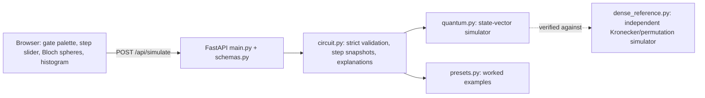

# Architecture

Author: Rayyan Anwar

## Flow
1. The UI sends `{n_qubits, gates[], shots, seed?}`. Pydantic checks types and ranges; `circuit.validate` re-checks everything (gate names, arity, qubit range and distinctness, angle present only for rotations, limits of 6 qubits, 60 gates, 100,000 shots).
2. `run_circuit` applies gates one at a time and stores a snapshot after each: amplitudes, probabilities, Bloch vector and entanglement entropy of every qubit, plus a plain-language explanation naming the gate and the three most likely outcomes.
3. Measurement is sampling from the exact final probabilities with a seed (returned, so results can be reproduced).

## Conventions
Qubit 0 is the leftmost bit of a basis label. The Bloch vector of a qubit is computed from its reduced density matrix; entropy 0 means the qubit is not entangled with the rest, 1 means maximally entangled. Teleportation uses the deferred-measurement form (controlled corrections instead of mid-circuit measurement).
